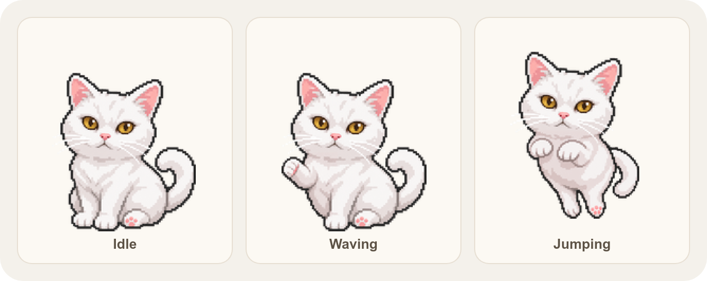
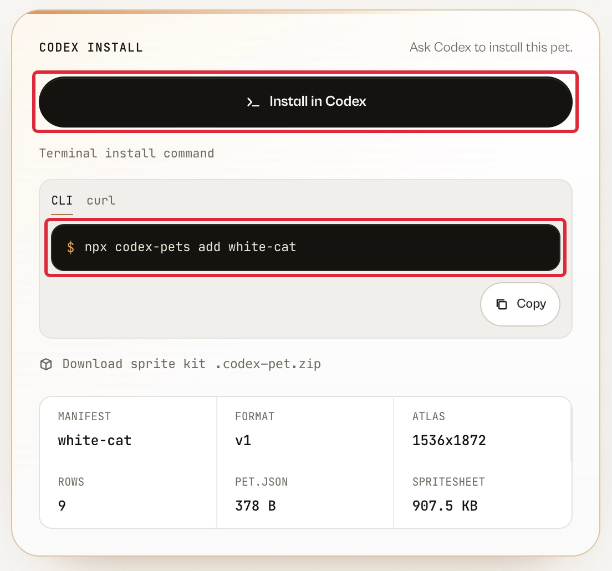
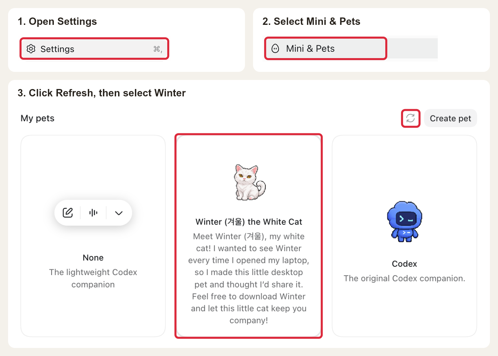

# Winter (겨울) the White Cat

Meet Winter (겨울), my white cat! I wanted to see Winter every time I opened my laptop, so I made this little desktop pet for Codex. Feel free to download Winter and let this little cat keep you company!

<p align="center">
  
</p>

## Install

With Node.js installed, ask Codex to run this command, or run it in your terminal:

```sh
npx codex-pets add white-cat
```

When the command finishes, look for `Installed Winter (겨울) the White Cat (white-cat)`.

You can also open [Winter’s gallery listing](https://codex-pets.net/share/white-cat) and select **Install in Codex** to open a chat with the install command ready to send.

<p align="center">
  
</p>

## Choose Winter in Codex

1. After the command finishes, open the profile menu in the desktop app and choose **Settings**.
2. In the Settings sidebar, select **Mini & Pets**.
3. Click the **Refresh** button next to **My pets**. **Winter (겨울) the White Cat** will appear in the list. Select the card to use Winter.

<p align="center">
  
</p>

Enter `/pet` in a Codex chat to show Winter on your desktop. See the [official Pets guide](https://learn.chatgpt.com/docs/pets) for more details.

## Animation preview

Download or clone this repository and open [`preview.html`](./preview.html) in your browser. You can watch all nine animation states and adjust the background, playback speed, and size.

The pet package includes [`pet.json`](./pet.json) for the metadata and [`spritesheet.webp`](./spritesheet.webp) for the animation frames.

## Contributors

- [@ninetybullets](https://github.com/ninetybullets)
