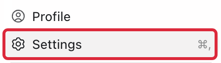
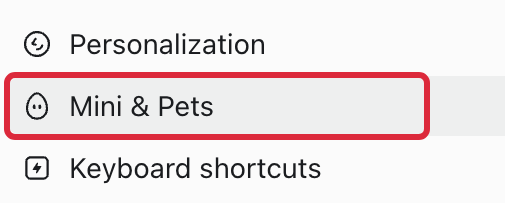
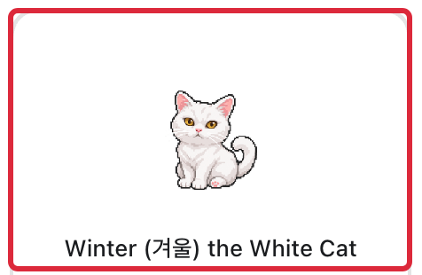
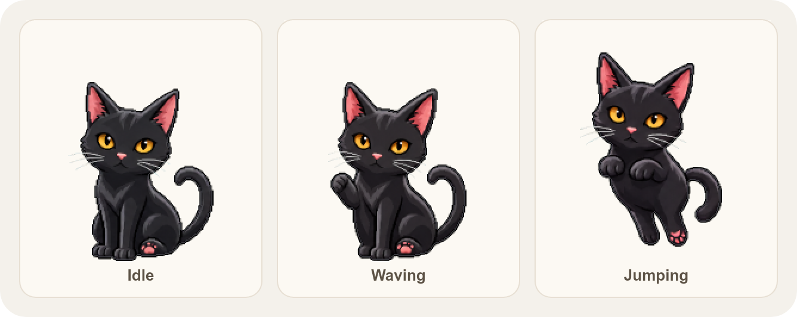
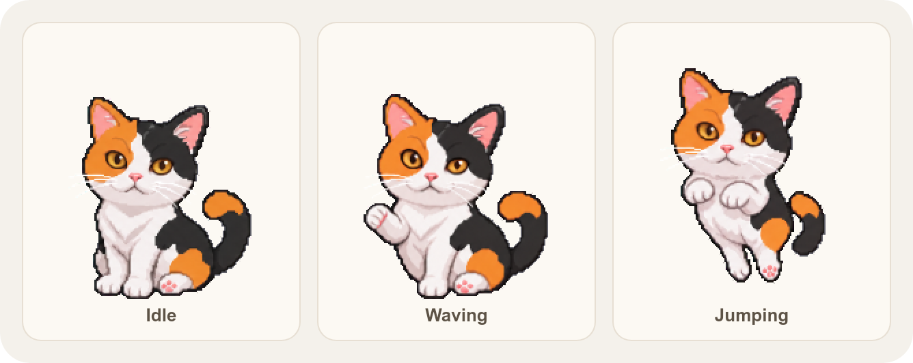

# Winter (겨울) the White Cat

Meet Winter (겨울), my white cat! I wanted to see Winter every time I opened my laptop, so I made this little desktop pet for Codex. Feel free to download Winter and let this little cat keep you company!

| Winter in motion |
| :---: |
|  |

## Install and choose Winter

With Node.js installed, ask Codex to run this command in the ChatGPT desktop app.

```sh
npx codex-pets add white-cat
```

When the command finishes, look for `Installed Winter (겨울) the White Cat (white-cat)`.

| Screenshot | What to do |
| :---: | :--- |
|  | **1. Download and install Winter**<br><br>On the **Codex Pets website**, open [Winter’s listing](https://codex-pets.net/share/white-cat) and click **Download sprite kit** to save the package.<br><br>In the **ChatGPT desktop app**, switch to **Codex**, open a chat, and ask Codex to run `npx codex-pets add white-cat`. The website’s **Install in Codex** button opens a chat with the command ready to send. |
|  | **2. Open Settings**<br><br>Once Codex finishes installing Winter, open the profile menu in the **ChatGPT desktop app** and select **Settings**. |
|  | **3. Go to Mini &amp; Pets**<br><br>In the **Settings** sidebar, select **Mini &amp; Pets**. |
|  | **4. Refresh the pet list**<br><br>On the **Mini &amp; Pets** page, find **My pets** and click the **Refresh** icon next to **Create pet**.<br><br>**Winter (겨울) the White Cat** will appear in the list. |
|  | **5. Select Winter**<br><br>In the **My pets** list, select **Winter (겨울) the White Cat** to use Winter. |

Enter `/pet` in a Codex chat to show Winter on your desktop. See the [official Pets guide](https://learn.chatgpt.com/docs/pets) for more details.

## Animation preview

Download or clone this repository and open [`preview.html`](./preview.html) in your browser. You can watch all nine animation states and adjust the background, playback speed, and size.

The pet package includes [`pet.json`](./pet.json) for the metadata and [`spritesheet.webp`](./spritesheet.webp) for the animation frames.

## Meet Kkamangi and Eollugi

Winter now has two friends! **Kkamangi (까망이) the Black Cat** in [`black-cat/`](./black-cat/) is a sleek black cat, and **Eollugi (얼룩이) the Calico Cat** in [`calico-cat/`](./calico-cat/) is a calico cat.

| Kkamangi in motion |
| :---: |
|  |

| Eollugi in motion |
| :---: |
|  |

Kkamangi and Eollugi are not on the Codex Pets website yet, so install them manually. Download or clone this repository and copy the pet’s folder into your Codex pets directory, `${CODEX_HOME:-$HOME/.codex}/pets/<id>/`.

```sh
cp -R black-cat ~/.codex/pets/
cp -R calico-cat ~/.codex/pets/
```

Then, in the **ChatGPT desktop app**, open **Settings** &gt; **Mini &amp; Pets**, click the **Refresh** icon next to **Create pet**, and select **Kkamangi (까망이) the Black Cat** or **Eollugi (얼룩이) the Calico Cat**.

To preview the animations, open each folder’s `preview.html` ([`black-cat/preview.html`](./black-cat/preview.html), [`calico-cat/preview.html`](./calico-cat/preview.html)) in your browser.

## Contributors

- [@ninetybullets](https://github.com/ninetybullets)
